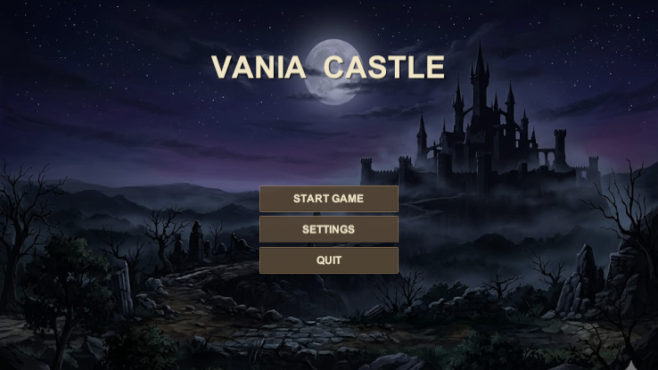
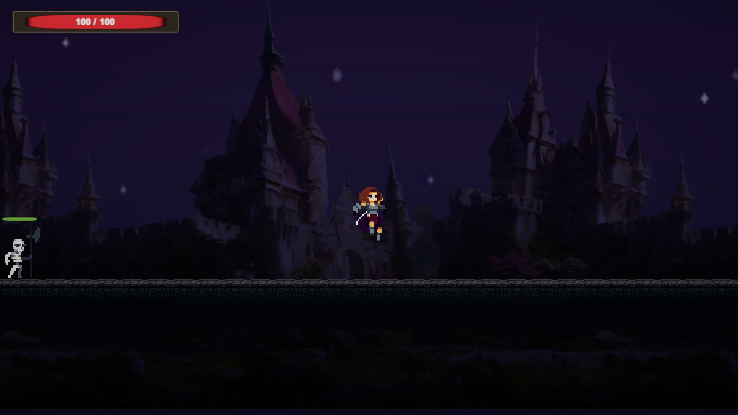

# Vania Castle｜類惡魔城 2D 動作遊戲原型

在夜晚的城堡外圍和骷髏戰鬥：近戰攻擊、反擊、衝刺、蹬牆跳，還能把劍丟出去再收回來。

## 玩法與操作

| 按鍵 | 動作 |
| --- | --- |
| A／D 或 ←／→ | 移動 |
| Space | 跳躍；貼牆時蹬牆跳 |
| Left Shift | 衝刺 |
| 滑鼠左鍵 | 近戰攻擊 |
| Q | 反擊 |
| 按住滑鼠右鍵瞄準，放開丟出 | 丟劍（劍在外面時再按右鍵收回） |
| E | 切換劍的種類 |
| Esc | 暫停選單 |

玩家與骷髏都有血量，被打到會扣血；骷髏歸零會消失，玩家歸零會重新開始本關。

## 設計重點

- **以狀態機組織角色行為**：待機、移動、跳躍、空中、貼牆、蹬牆跳、衝刺、攻擊、反擊、瞄準、接劍各是一個狀態，新增動作只要加狀態，不用改一大段 if。
- **背刺判定共用一個函式**：近戰、丟劍、分身都用 `Entity.IsBackAttacked` 判斷攻擊方向，避免同一條規則散在多處、改一處漏一處。
- **夜晚城堡的畫面**：URP 2D 加上 Bloom、Vignette 與色調調整，遠景是可平鋪的星空、近景是城堡剪影，解決原本三張重複背景的穿幫。
- **完整的遊戲外殼**：主選單、音量設定（會記住）、暫停選單。

## 試玩與開啟專案

- **Windows 試玩版**：[下載 VaniaCastle_v1.1_Win64.zip](https://github.com/barryclown/VaniaCastle/releases/download/v1.1/VaniaCastle_v1.1_Win64.zip)（Releases v1.1），解壓後執行裡面的 exe。
- **開專案**：Unity 2022.3.62f2（URP 2D）。起始場景是 `Assets/Scenes/MainMenu.unity`，關卡在 `Assets/Scenes/SampleScene.unity`。

## 專案結構

| 位置 | 內容 |
| --- | --- |
| `Assets/script/PlayerState/` | 玩家各狀態與狀態機 |
| `Assets/script/Entity.cs` | 玩家與敵人共用：血量、受傷、背刺判定、翻面 |
| `Assets/script/UI/` | 主選單、暫停選單、玩家與敵人血條 |
| `Assets/Graphics/Backgrounds/` | 夜空與城堡背景 |

## 限制

- 目前只有一個關卡與一種敵人（骷髏），是動作手感與系統的原型。
- 介面文字只有英文。
- 只測過 Windows。

## 素材與授權

未另行授權，程式與素材保留所有權利；第三方素材的權利屬於原作者。
